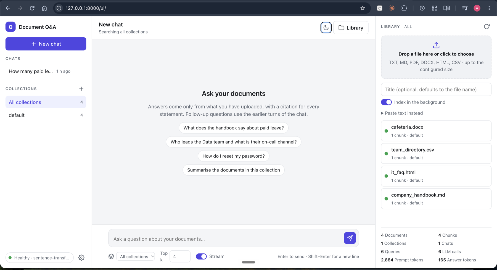

# RAG Document Q&A

Ask questions about your own documents and get answers that cite them. A small, self-contained Retrieval-Augmented Generation service: **FastAPI**, **ChromaDB**, **SQLite**, local or remote embeddings, any OpenAI-compatible chat model (or none), and a web UI, all in one process and one Docker image.



Upload TXT, Markdown, PDF, DOCX, HTML or CSV files. They are split into overlapping chunks, embedded and indexed. A question retrieves the most relevant chunks, the model answers from those chunks only, and every statement carries a `[S1]`-style citation back to the chunk it came from. It runs on a laptop with no keys at all, and scales up to a hosted model when you give it one.

## Features

**Ingestion**
- TXT, Markdown, text-based PDF, DOCX, HTML and CSV, checked by extension and, for PDF and DOCX, by their leading bytes
- Synchronous by default, or `?background=true` for a `202` and a status to poll; nothing is ever written to disk except the chunks and vectors
- SHA-256 deduplication per collection; word-window chunking with overlap

**Retrieval and answers**
- Cosine search in ChromaDB, over-fetching, a relevance threshold, and a token budget sized to the model's context window
- A prompt that frames chunks as reference data, not instructions, and asks for citations; the model is told plainly when nothing relevant was found
- Streaming answers over Server-Sent Events
- Works offline with an extractive answerer; with an LLM, any `/v1/chat/completions` server (Ollama, vLLM, OpenAI, Google AI Studio…), with fallback providers and per-call token usage logging

**Organisation**
- Collections that scope documents and questions
- Conversations: a follow-up is rewritten into a standalone search query using the earlier turns, then answered in context

**Operations and safety**
- API-key authentication with admin-managed keys, off by default
- Guardrails that flag or redact personal data, secrets and prompt-injection phrases in questions, answers and retrieved chunks
- Health checks with a deep mode that exercises the embedder and every LLM provider; usage totals; request ids and timing headers; versioned SQLite migrations

**Developer experience**
- A chat-style web UI at `/ui/` with no build step
- 206 offline tests, ruff, and GitHub Actions that also build and health-check the Docker image
- Dependency injection throughout, so every component has a test double

## Quick start

Python 3.11 or 3.12.

```bash
git clone https://github.com/heyush79/rag-document-qa.git
cd rag-document-qa
python3 -m venv .venv && source .venv/bin/activate     # Windows: py -3.12 -m venv .venv; .\.venv\Scripts\Activate.ps1
pip install -e ".[local,dev]"
cp .env.example .env
uvicorn app.main:create_app --factory --reload
```

Open **http://127.0.0.1:8000/ui/**, drop `sample_data/company_handbook.md` into the Library and ask *How many paid leave days do employees get?* The first ingestion downloads the embedding model (about 90 MB); after that it is cached.

With no `.env` changes the app answers with its offline extractive generator, so no key is needed. For real answers, point it at a model (see [LLM providers](#llm-providers)); Google AI Studio has a free tier:

```env
RAG_ANSWER_PROVIDER=openai-compatible
RAG_LLM_BASE_URL=https://generativelanguage.googleapis.com/v1beta/openai
RAG_LLM_API_KEY=your-ai-studio-key
RAG_LLM_MODEL=gemini-2.5-flash
```

Other entry points: Swagger at `/docs`, health at `/api/v1/health`, and `make install`, `make run`, `make test` (use `make install PYTHON=python3.12` if your default Python is newer than 3.12).

The `local` extra installs Sentence Transformers and torch for local embeddings. Skip it for a much smaller install and use a remote embedding API or the hashing backend instead; the app says so at startup if the local backend is selected without it.

## Web UI

`/ui/` is a chat-style app that drives the whole API:

- **Chats** in the left sidebar. A chat is created on its first question and titled after it. Follow-up questions use the earlier turns, and the answer's footer shows what a follow-up was rewritten to for retrieval.
- **Collections** below the chats: create one, pick it as the scope for questions and for the document list, delete it (cascading, after a confirmation). A chat bound to a collection keeps that scope.
- **Answers** render Markdown, stream in by default, and carry numbered citation pills that open the matching source card, with its relevance score, chunk and text. Guardrail warnings appear as amber chips.
- **Library** on the right: drag and drop files or paste text, background indexing on by default with a live status, delete, and usage totals.
- **Settings**: the API key for when authentication is on (remembered in the browser), light, dark or system theme, and a deep health check.

It is three files of plain HTML, CSS and JavaScript in `app/static/`, served by FastAPI itself: no build step, no Node, nothing extra to deploy.

## Using the API

Everything the UI does is a plain HTTP call. The essentials:

```bash
# Ingest text, or upload a file (add ?background=true to either for a 202 and a status to poll)
curl -X POST http://127.0.0.1:8000/api/v1/documents/text -H "Content-Type: application/json" \
  -d '{"title": "Handbook", "text": "Employees receive 24 paid leave days per calendar year."}'
curl -X POST http://127.0.0.1:8000/api/v1/documents/upload -F "file=@sample_data/company_handbook.md"

# Ask, or stream the answer as Server-Sent Events (-N stops curl buffering)
curl -X POST http://127.0.0.1:8000/api/v1/query -H "Content-Type: application/json" \
  -d '{"question": "How many paid leave days do employees receive?", "top_k": 4}'
curl -N -X POST http://127.0.0.1:8000/api/v1/query/stream -H "Content-Type: application/json" \
  -d '{"question": "How many paid leave days do employees receive?"}'
```

A query response carries the `answer`, the `sources` it was built from (`[Sn]` refers to `sources[n-1]`), the `search_query` actually used, the `conversation_id` if any, guardrail `warnings`, and timings.

| Method | Endpoint | Purpose |
|---|---|---|
| GET | `/api/v1/health` | SQLite and ChromaDB health; `?deep=true` also checks the embedder and each LLM provider |
| POST | `/api/v1/documents/text` | Ingest raw text, optionally into a collection; `?background=true` returns 202 at once |
| POST | `/api/v1/documents/upload` | Upload TXT, MD, PDF, DOCX, HTML or CSV, optionally into a collection; `?background=true` as above |
| GET | `/api/v1/documents` | List documents, optionally by collection |
| GET / DELETE | `/api/v1/documents/{id}` | Get a document's metadata and status, or delete it with its vectors |
| POST | `/api/v1/query` | Retrieve chunks and answer, across everything, one collection, or within a conversation |
| POST | `/api/v1/query/stream` | The same, streamed as Server-Sent Events |
| POST / GET | `/api/v1/collections` | Create, or list with document counts |
| GET / DELETE | `/api/v1/collections/{id}` | Get, or delete (an empty one; everything in it with `?cascade=true`) |
| POST / GET | `/api/v1/conversations` | Start one (optionally bound to a collection), or list |
| GET / DELETE | `/api/v1/conversations/{id}` | Get with its messages, or delete |
| GET | `/api/v1/queries` | Recent query history |
| GET | `/api/v1/stats` | Document, chunk, collection, conversation and query counts, plus LLM calls and tokens |
| POST / GET | `/api/v1/api-keys` | Create a key, or list them (admin key required) |
| DELETE | `/api/v1/api-keys/{id}` | Revoke a key (admin key required) |

[docs/API.md](docs/API.md) has request and response examples for each; [docs/ARCHITECTURE.md](docs/ARCHITECTURE.md) explains the flows.

## How answers are produced

1. **Scope.** A `collection_id` limits the search to that collection's documents; a `conversation_id` brings in the chat's recent turns (at most `RAG_HISTORY_MAX_TURNS`, within `RAG_HISTORY_TOKEN_LIMIT` estimated tokens).
2. **Guardrails.** The question is checked for personal data, secrets and injection phrases; in `redact` mode they are replaced before anything else sees it.
3. **Rewrite.** With history and an LLM, the question is rewritten into a standalone search query ("And what about remote work?" becomes "remote work policy days per week"). If that fails, the question itself is searched.
4. **Retrieve.** The vector store is asked for more chunks than `top_k`; chunks below `RAG_MIN_RELEVANCE_SCORE` are dropped, and the best that fit the token budget (`RAG_LLM_CONTEXT_WINDOW` minus `RAG_LLM_RESERVED_TOKENS`, less a margin) are kept.
5. **Answer.** The prompt is the system instructions, the earlier turns, then the chunks in numbered `<document>` tags framed as reference data, then the original question. The model cites `[S1]`, `[S2]`… If nothing relevant was found, it is told so rather than handed an empty context. The extractive provider instead returns the best matching sentences with the same citations.
6. **Record.** The query, its sources, every LLM call with its token usage, and, in a conversation, the question and answer are saved.

This limits hallucination; it does not abolish it. No prompt can.

## Configuration

Everything is an environment variable with the `RAG_` prefix, read from `.env`. [.env.example](.env.example) lists them all with comments; the ones you are most likely to change:

| Setting | Default | What it does |
|---|---|---|
| `RAG_ANSWER_PROVIDER` | `extractive` | `extractive` needs no model; `openai-compatible` uses the `RAG_LLM_*` settings |
| `RAG_LLM_BASE_URL`, `RAG_LLM_MODEL`, `RAG_LLM_API_KEY` | – | The primary chat model: any `/v1/chat/completions` server |
| `RAG_LLM_FALLBACKS` | `[]` | JSON list of `{base_url, model, api_key}` tried in order when the primary fails |
| `RAG_LLM_CONTEXT_WINDOW`, `RAG_LLM_RESERVED_TOKENS` | `8192`, `2000` | Sizes the retrieval token budget to the model |
| `RAG_LLM_TIMEOUT_SECONDS` | `60` | Per request to an LLM or embedding API |
| `RAG_EMBEDDING_BACKEND` | `sentence-transformers` | Or `openai-compatible` (with `RAG_EMBEDDING_BASE_URL`, `RAG_EMBEDDING_API_KEY`, `RAG_EMBEDDING_BATCH_SIZE`) or `hashing` for offline smoke runs |
| `RAG_EMBEDDING_MODEL` | `sentence-transformers/all-MiniLM-L6-v2` | The embedding model for either backend |
| `RAG_CHROMA_COLLECTION` | `documents` | Change it whenever you change the embedding model: vectors from different models can't be mixed, and the app refuses to try |
| `RAG_MIN_RELEVANCE_SCORE` | `0.15` | Chunks below it are never used. Right for MiniLM; Gemini embeddings score unrelated text around 0.5, so start near 0.55 there |
| `RAG_DEFAULT_TOP_K`, `RAG_CHUNK_SIZE_WORDS`, `RAG_CHUNK_OVERLAP_WORDS` | `4`, `180`, `30` | Retrieval and chunking |
| `RAG_MAX_UPLOAD_MB` | `10` | Upload size cap |
| `RAG_AUTH_ENABLED`, `RAG_ADMIN_API_KEY` | `false`, – | Require API keys; the admin key manages them and works everywhere |
| `RAG_GUARDRAILS_MODE` | `flag` | `off`, `flag` or `redact` |
| `RAG_HISTORY_MAX_TURNS`, `RAG_HISTORY_TOKEN_LIMIT` | `6`, `1000` | How much of a conversation travels with a follow-up |
| `RAG_SQLITE_PATH`, `RAG_CHROMA_PATH` | `data/rag.db`, `data/chroma` | Where the data lives; mount `./data` as a volume in Docker |

Restart the API after changing `.env`. Keep keys in `.env`, which git ignores, never in `.env.example`.

## LLM providers

Any endpoint that implements `/v1/chat/completions` works, and for streaming it must support `"stream": true`, as Ollama, vLLM, OpenAI and Google AI Studio do. A local Ollama server:

```env
RAG_ANSWER_PROVIDER=openai-compatible
RAG_LLM_BASE_URL=http://localhost:11434/v1
RAG_LLM_API_KEY=local-key
RAG_LLM_MODEL=llama3.2:3b
```

**Fallbacks.** `RAG_LLM_FALLBACKS` lists extra providers, tried in order when the primary one fails with an error, a timeout or a rate limit. A streamed answer only falls back before any text has been sent; after that the stream ends with an `error` event rather than restarting with a different model.

```env
RAG_LLM_FALLBACKS='[{"base_url": "http://localhost:11434/v1", "model": "llama3.2:3b", "api_key": "local-key"}]'
```

**Usage and health.** Every attempt to call a provider is logged with its token usage, latency and outcome, against the query it served; `GET /api/v1/stats` totals them under `llm_usage`. `GET /api/v1/health?deep=true` embeds a test string and calls `GET /models` on each provider, so you learn which key or server is broken before a user does.

## Embeddings

The default runs Sentence Transformers locally (`all-MiniLM-L6-v2`, 384 dimensions). To avoid installing torch, or to use a larger model, point the `openai-compatible` backend at any `POST /v1/embeddings` server:

```env
RAG_EMBEDDING_BACKEND=openai-compatible
RAG_EMBEDDING_BASE_URL=https://generativelanguage.googleapis.com/v1beta/openai
RAG_EMBEDDING_API_KEY=your-ai-studio-key
RAG_EMBEDDING_MODEL=gemini-embedding-001
RAG_CHROMA_COLLECTION=documents_gemini
RAG_MIN_RELEVANCE_SCORE=0.55
```

Texts go in batches of `RAG_EMBEDDING_BATCH_SIZE`. Relevance scores depend on the model: MiniLM scores unrelated text near 0, so 0.15 works for it; Gemini embeddings scored unrelated questions 0.45 to 0.52 and relevant ones 0.56 to 0.67 on the sample data, so start around 0.55 and tune on your own documents. `hashing` is a deterministic, download-free backend for smoke runs and tests.

## Collections and conversations

Every document belongs to one collection; without a `collection_id` it goes into the built-in `default`. Duplicate detection is per collection, so the same text can live in two collections but not twice in one. A question with a `collection_id` searches only that collection. Deleting a collection that still has documents is refused unless you pass `?cascade=true`, which removes its documents, vectors and conversations; `default` can't be deleted.

A conversation gives follow-up questions their context. Create one (optionally bound to a collection), pass its id with each question, and both the question and the answer are saved to it. An untitled conversation takes its first question as its title. With an LLM configured, a follow-up is rewritten into a standalone search query first; the response's `search_query` shows what was searched, and the model still answers the question as asked.

## Authentication

Off by default, with a warning at startup. To require keys:

```env
RAG_AUTH_ENABLED=true
RAG_ADMIN_API_KEY=a-long-random-string
```

```bash
curl -X POST http://127.0.0.1:8000/api/v1/api-keys \
  -H "Authorization: Bearer $RAG_ADMIN_API_KEY" -H "Content-Type: application/json" \
  -d '{"name": "reporting"}'
# {"id": "...", "name": "reporting", "prefix": "rag_XXXXXXXX", "key": "rag_...", ...}
curl http://127.0.0.1:8000/api/v1/stats -H "Authorization: Bearer rag_..."
```

The key is shown once; only its SHA-256 hash is stored. `/`, `/api/v1/health`, the docs and the UI page stay open. The admin key works on every route and is the only one that can create, list or revoke keys. A request without a valid key gets a 401. There is one tenant: any valid key sees all documents. The scripts in `scripts/` read `RAG_API_KEY`.

## Guardrails

Every query is checked for emails, phone numbers, card numbers (Luhn-validated), common API-key formats (`sk-…`, `AKIA…`, `ghp_…`, `xox…-…`) and prompt-injection phrases such as "ignore previous instructions". `RAG_GUARDRAILS_MODE` decides what happens:

- `flag` (default): matches are logged and listed under `warnings` in the response, with the kind, where they were found (`question`, `answer` or `source`) and a count. Nothing is changed.
- `redact`: personal data and keys are also replaced with placeholders such as `[REDACTED_EMAIL]`, in the question before retrieval and in the answer before it is returned or saved. The streamed route holds each sentence back until it is complete, so a phone number split across two pieces is still caught.
- `off`: no checks.

Retrieved chunks are only ever flagged, never changed: a document that tries to instruct the model shows up as an `injection` warning naming the document. Pattern matching is a cheap first line, not a classifier; the architecture doc says what it won't catch.

## Running in Docker

```bash
docker build -t rag-document-qa .
docker run --rm -p 8000:8000 --env-file .env -v "$(pwd)/data:/app/data" rag-document-qa
# or
docker compose up --build
```

The `./data` volume keeps SQLite and ChromaDB across restarts. The image includes Sentence Transformers with CPU-only torch; for a much smaller image that uses a remote embedding API or the hashing backend, build with `--build-arg LOCAL_EMBEDDINGS=false` (or `LOCAL_EMBEDDINGS=false docker compose up --build`). CI builds that variant and checks its health on every change.

## Tests and CI

```bash
python -m pytest -q          # 206 passed
ruff check app tests scripts
python -m pytest --cov=app --cov-report=term-missing
```

The tests are fully offline: an in-memory vector store, deterministic hashing embeddings, and a mock OpenAI-compatible server (including streaming) built on `httpx.MockTransport`. GitHub Actions runs them with ruff on every push to `main` and every pull request, and builds and health-checks the Docker image ([.github/workflows/ci.yml](.github/workflows/ci.yml)).

## Project structure

```text
rag-document-qa/
├── .github/workflows/ci.yml    # Lint, tests and a Docker build on GitHub Actions
├── app/
│   ├── agents/                 # Ingestion, retrieval, answer and orchestration
│   ├── api/                    # Routes, API-key checks, the UI mount
│   ├── core/                   # Exceptions, logging, key generation and hashing
│   ├── db/                     # SQLite migrations and repositories
│   ├── services/               # Parsing, chunking, embeddings, vector store, LLM client,
│   │                           # prompting, guardrails, collections, conversations
│   ├── static/                 # The web UI
│   ├── config.py               # Settings (environment variables with the RAG_ prefix)
│   ├── container.py            # Dependency wiring
│   ├── main.py                 # FastAPI application factory
│   └── schemas.py              # Request and response models
├── docs/
│   ├── API.md                  # Request and response examples
│   ├── ARCHITECTURE.md         # Flows, design decisions, limits
│   ├── IMPLEMENTATION_PLAN.md  # How the DocsGPT-inspired features were planned and built
│   └── images/ui.png
├── sample_data/                # A handbook, product notes, an HTML FAQ and a CSV directory
├── scripts/                    # ingest_sample.py and smoke_test.py
├── tests/                      # 206 tests
├── .env.example                # Every setting, with comments
├── Dockerfile, docker-compose.yml, Makefile, pyproject.toml
└── README.md
```

## How it was built

The project started as a basic ingest-and-answer API and was then taken through a planned sequence of phases, each borrowed from what [DocsGPT](https://github.com/arc53/DocsGPT) does well, scaled to a small single-process deployment: retrieval and prompt quality, streaming, provider fallback and usage logging, API keys, collections, conversations with query rewriting, background ingestion and more file types, guardrails, and the web UI. [docs/IMPLEMENTATION_PLAN.md](docs/IMPLEMENTATION_PLAN.md) records each phase, the decisions taken along the way, what was checked against a real model, and the backlog: hosted Postgres with pgvector, hybrid search, an OpenAI-compatible endpoint of its own, per-collection retrieval settings, and idempotency keys.

## Limits

This is production-style, not a claim that a single-process laptop service should run a bank. Before exposing it widely, you would want per-tenant authorization, a durable job queue for ingestion, rate limiting, malware scanning of uploads, OCR for scanned PDFs, reranking, an evaluation set to tune the relevance threshold against, metrics export, and a managed database once the corpus outgrows local disk. [docs/ARCHITECTURE.md](docs/ARCHITECTURE.md) goes through each.
