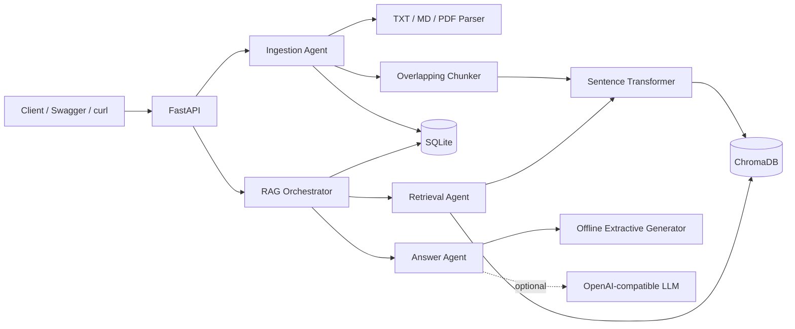

# RAG Document Q&A System

A production-style local Retrieval-Augmented Generation service built with **Python, FastAPI, ChromaDB, Sentence Transformers, SQLite, and Pytest**.

The project ingests TXT, Markdown, and text-based PDF files, splits them into overlapping chunks, generates embeddings, stores vectors in ChromaDB, keeps operational metadata in SQLite, retrieves relevant chunks for a question, and returns a grounded answer with source references.

## What is included

- FastAPI REST API with Swagger documentation
- Text, Markdown, and PDF ingestion
- SHA-256 content deduplication
- Word-window chunking with configurable overlap
- Sentence Transformers embeddings
- Persistent ChromaDB vector search with cosine distance
- SQLite document metadata, query history, source traces, and audit events
- Offline extractive answer generator, so the application works without an LLM key
- Optional OpenAI-compatible answer generator for a local or hosted model
- Agent-style orchestration for ingestion, retrieval, and answer generation
- Request IDs, processing-time headers, health checks, and structured errors
- Dependency injection for deterministic tests
- **21 passing Pytest tests**
- Architecture and interview narration documentation

## Architecture at a glance



See [docs/ARCHITECTURE.md](docs/ARCHITECTURE.md) for the detailed flow.

## Local setup in VS Code

### 1. Prerequisites

Use **Python 3.11 or 3.12**. From the VS Code terminal:

```bash
python3 --version
```

### 2. Create and activate a virtual environment

```bash
cd rag-document-qa
python3 -m venv .venv
source .venv/bin/activate
```

On Windows PowerShell:

```powershell
cd rag-document-qa
py -3.12 -m venv .venv
.\.venv\Scripts\Activate.ps1
```

### 3. Install dependencies

```bash
python -m pip install --upgrade pip
pip install -e ".[dev]"
```

### 4. Create local configuration

```bash
cp .env.example .env
```

The default embedding model is:

```text
sentence-transformers/all-MiniLM-L6-v2
```

The first ingestion or query may download the model. After that, the model is cached locally. For a zero-model-download smoke run, change this in `.env`:

```env
RAG_EMBEDDING_BACKEND=hashing
RAG_CHROMA_COLLECTION=documents_hashing
```

Use a different collection name when changing embedding backends because persisted vectors must have the same dimension and embedding space.

### 5. Select the interpreter in VS Code

Open the Command Palette:

```text
Python: Select Interpreter
```

Choose:

```text
<project-folder>/.venv/bin/python
```

### 6. Start the API

```bash
uvicorn app.main:create_app --factory --reload
```

Open:

- Swagger UI: `http://127.0.0.1:8000/docs`
- Health endpoint: `http://127.0.0.1:8000/api/v1/health`

## Run the complete flow

### Ingest a document

```bash
curl -X POST "http://127.0.0.1:8000/api/v1/documents/text" \
  -H "Content-Type: application/json" \
  -d '{
    "title": "Acme Engineering Handbook",
    "source": "sample_data/company_handbook.md",
    "text": "Employees receive 24 paid leave days per calendar year. Leave requests longer than five consecutive working days should be submitted at least two weeks in advance."
  }'
```

Or ingest the provided sample file while the server is running:

```bash
python scripts/ingest_sample.py
```

### Upload a TXT, Markdown, or PDF file

```bash
curl -X POST "http://127.0.0.1:8000/api/v1/documents/upload" \
  -F "file=@sample_data/company_handbook.md" \
  -F "title=Acme Engineering Handbook"
```

### Ask a question

```bash
curl -X POST "http://127.0.0.1:8000/api/v1/query" \
  -H "Content-Type: application/json" \
  -d '{
    "question": "How many paid leave days do employees receive?",
    "top_k": 4
  }'
```

Example response shape:

```json
{
  "query_id": "...",
  "question": "How many paid leave days do employees receive?",
  "answer": "Full-time employees receive 24 paid leave days per calendar year. [S1]",
  "sources": [
    {
      "rank": 1,
      "chunk_id": "document-id:0",
      "document_id": "document-id",
      "document_title": "Acme Engineering Handbook",
      "source": "sample_data/company_handbook.md",
      "chunk_index": 0,
      "text": "...",
      "score": 0.73,
      "start_char": 0,
      "end_char": 850
    }
  ],
  "latency_ms": 14.2
}
```

## API endpoints

| Method | Endpoint | Purpose |
|---|---|---|
| GET | `/` | Service metadata |
| GET | `/api/v1/health` | SQLite and ChromaDB health |
| POST | `/api/v1/documents/text` | Ingest raw text |
| POST | `/api/v1/documents/upload` | Upload TXT, MD, or PDF |
| GET | `/api/v1/documents` | List documents |
| GET | `/api/v1/documents/{id}` | Get document metadata |
| DELETE | `/api/v1/documents/{id}` | Delete metadata and vectors |
| POST | `/api/v1/query` | Retrieve chunks and answer |
| GET | `/api/v1/queries` | Recent query history |
| GET | `/api/v1/stats` | Document, vector, and query counts |

More examples are in [docs/API.md](docs/API.md).

## Use an OpenAI-compatible local model

The application works in offline extractive mode by default. To use a generative model, configure any endpoint that implements `/v1/chat/completions`.

Example for an OpenAI-compatible local server:

```env
RAG_ANSWER_PROVIDER=openai-compatible
RAG_LLM_BASE_URL=http://localhost:11434/v1
RAG_LLM_API_KEY=local-key
RAG_LLM_MODEL=llama3.2:3b
```

Restart the API after changing `.env`.

The answer prompt instructs the model to use only retrieved context, attach `[S1]`-style citations, and admit when context is insufficient. This reduces hallucination risk, although no prompt can abolish it completely. Humanity remains undefeated at inventing confident nonsense.

## Run tests

```bash
python -m pytest -q
```

Expected result:

```text
.....................                                                    [100%]
21 passed
```

Coverage report:

```bash
python -m pytest --cov=app --cov-report=term-missing
```

The tests use an in-memory vector-store implementation and deterministic hashing embeddings. Production code uses the ChromaDB adapter and Sentence Transformers. This keeps tests fast, offline, and free from model-download flakiness.

## Docker

```bash
docker build -t rag-document-qa .
docker run --rm -p 8000:8000 -v "$(pwd)/data:/app/data" rag-document-qa
```

Or:

```bash
docker compose up --build
```

## Project structure

```text
rag-document-qa/
├── app/
│   ├── agents/                 # Ingestion, retrieval, answer, orchestration
│   ├── api/routes.py           # REST endpoints
│   ├── core/                   # Exceptions and logging
│   ├── db/                     # SQLite schema and repositories
│   ├── services/               # Chunking, embedding, vector store, parsing
│   ├── config.py               # Environment-based settings
│   ├── container.py            # Dependency wiring
│   ├── main.py                 # FastAPI application factory
│   └── schemas.py              # Request and response models
├── docs/
│   ├── API.md
│   ├── ARCHITECTURE.md
│   └── INTERVIEW_GUIDE.md
├── sample_data/
├── scripts/
├── tests/                      # 21 tests
├── .env.example
├── Dockerfile
├── docker-compose.yml
├── Makefile
├── pyproject.toml
└── README.md
```

## Production considerations

This is production-style, not a claim that a single-process laptop service should run a bank.

For a larger deployment, add authentication and authorization, object storage for originals, malware scanning, OCR for scanned PDFs, background ingestion jobs, reranking, evaluation datasets, metrics export, distributed tracing, rate limiting, a managed vector database, and a queue-backed consistency repair process.

## Interview material

Read [docs/INTERVIEW_GUIDE.md](docs/INTERVIEW_GUIDE.md). It contains:

- 60-second and 3-minute project explanations
- Complete ingestion and query flows
- Why both ChromaDB and SQLite are used
- Agent responsibilities
- Failure handling and consistency trade-offs
- Scaling plan
- Common follow-up questions and strong answers
