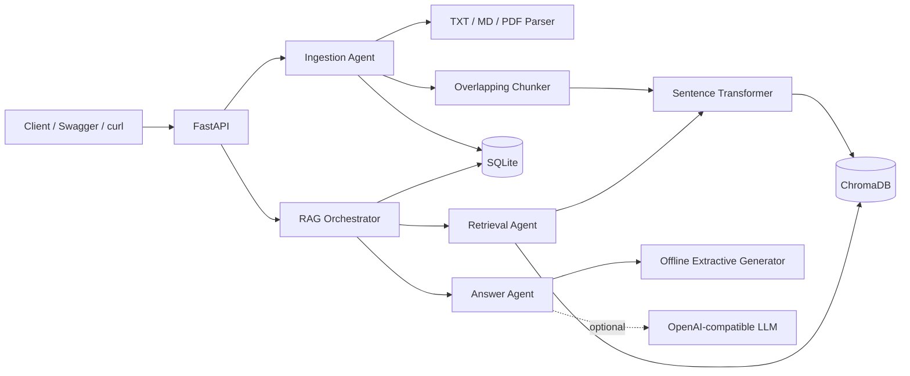

# RAG Document Q&A System

A production-style local Retrieval-Augmented Generation service built with **Python, FastAPI, ChromaDB, Sentence Transformers, SQLite, and Pytest**.

The project ingests TXT, Markdown, text-based PDF, DOCX, HTML and CSV files, splits them into overlapping chunks, generates embeddings, stores vectors in ChromaDB, keeps operational metadata in SQLite, retrieves relevant chunks for a question, and returns a grounded answer with source references.

## What is included

- FastAPI REST API with Swagger documentation
- Text, Markdown, PDF, DOCX, HTML and CSV ingestion, synchronous or in the background
- Collections that group documents, with per-collection duplicate detection and scoped search
- Conversations: follow-up questions are rewritten into standalone search queries and answered with the earlier turns as context
- SHA-256 content deduplication
- Word-window chunking with configurable overlap
- Sentence Transformers embeddings locally, or any OpenAI-compatible embedding API
- Persistent ChromaDB vector search with cosine distance
- SQLite document metadata, query history, source traces, and audit events
- Offline extractive answer generator, so the application works without an LLM key
- Optional OpenAI-compatible answer generator for a local or hosted model, with fallback providers and per-call token usage logging
- Streaming answers as Server-Sent Events
- Agent-style orchestration for ingestion, retrieval, and answer generation
- API-key authentication, off by default, with admin-managed keys stored as hashes
- Request IDs, processing-time headers, health checks with an optional deep provider check, and structured errors
- Dependency injection for deterministic tests
- **169 passing Pytest tests**, run by GitHub Actions on every pull request
- Architecture documentation

## Architecture at a glance



See [docs/ARCHITECTURE.md](docs/ARCHITECTURE.md) for the detailed flow.

## Local setup in VS Code

### 1. Prerequisites

Use **Python 3.11 or 3.12**. From the VS Code terminal:

```bash
python3 --version
```

### 2. Create and activate a virtual environment

```bash
cd rag-document-qa
python3 -m venv .venv
source .venv/bin/activate
```

On Windows PowerShell:

```powershell
cd rag-document-qa
py -3.12 -m venv .venv
.\.venv\Scripts\Activate.ps1
```

### 3. Install dependencies

```bash
python -m pip install --upgrade pip
pip install -e ".[local,dev]"
```

The `local` extra is Sentence Transformers (and torch) for the default local embedding backend. Leave it out for a smaller install and use the `openai-compatible` or `hashing` embedding backend instead; the app says so at startup if the local backend is selected without it.

### 4. Create local configuration

```bash
cp .env.example .env
```

The default embedding model is:

```text
sentence-transformers/all-MiniLM-L6-v2
```

The first ingestion or query may download the model. After that, the model is cached locally. For a zero-model-download smoke run, change this in `.env`:

```env
RAG_EMBEDDING_BACKEND=hashing
RAG_CHROMA_COLLECTION=documents_hashing
```

Use a different collection name when changing embedding backends because persisted vectors must have the same dimension and embedding space.

### 5. Select the interpreter in VS Code

Open the Command Palette:

```text
Python: Select Interpreter
```

Choose:

```text
<project-folder>/.venv/bin/python
```

### 6. Start the API

```bash
uvicorn app.main:create_app --factory --reload
```

Open:

- Swagger UI: `http://127.0.0.1:8000/docs`
- Health endpoint: `http://127.0.0.1:8000/api/v1/health`

## Run the complete flow

### Ingest a document

```bash
curl -X POST "http://127.0.0.1:8000/api/v1/documents/text" \
  -H "Content-Type: application/json" \
  -d '{
    "title": "Acme Engineering Handbook",
    "source": "sample_data/company_handbook.md",
    "text": "Employees receive 24 paid leave days per calendar year. Leave requests longer than five consecutive working days should be submitted at least two weeks in advance."
  }'
```

Or ingest the provided sample file while the server is running:

```bash
python scripts/ingest_sample.py
```

### Upload a file

```bash
curl -X POST "http://127.0.0.1:8000/api/v1/documents/upload" \
  -F "file=@sample_data/company_handbook.md" \
  -F "title=Acme Engineering Handbook"
```

TXT, Markdown, text-based PDF, DOCX, HTML and CSV are accepted, by extension and, for PDF and DOCX, by checking the file's leading bytes. HTML keeps the visible text and drops scripts and styles; CSV becomes one "column: value" block per row. Scanned PDFs and audio are out of scope.

Add `?background=true` to either ingestion route to get a `202` as soon as the document is registered, with chunking and embedding continuing in the background. Poll `GET /api/v1/documents/{id}` until its `status` is `ready` or `failed`. A bad file still gets its 415 at once, and a duplicate still gets the existing document with a 200. The text is held in memory for the task, never written to disk, so a document that was still processing when the app restarts is marked `failed` at startup with "interrupted by restart; upload again".

### Ask a question

```bash
curl -X POST "http://127.0.0.1:8000/api/v1/query" \
  -H "Content-Type: application/json" \
  -d '{
    "question": "How many paid leave days do employees receive?",
    "top_k": 4
  }'
```

Example response shape:

```json
{
  "query_id": "...",
  "question": "How many paid leave days do employees receive?",
  "answer": "Full-time employees receive 24 paid leave days per calendar year. [S1]",
  "sources": [
    {
      "rank": 1,
      "chunk_id": "document-id:0",
      "document_id": "document-id",
      "document_title": "Acme Engineering Handbook",
      "source": "sample_data/company_handbook.md",
      "chunk_index": 0,
      "text": "...",
      "score": 0.73,
      "start_char": 0,
      "end_char": 850
    }
  ],
  "latency_ms": 14.2
}
```

### Stream the answer

`/api/v1/query/stream` takes the same body and sends the answer as Server-Sent Events while the model writes it: a `source` event first, then `answer` events with the next piece of text, then `end` (or `error`). `-N` stops curl from buffering:

```bash
curl -N -X POST "http://127.0.0.1:8000/api/v1/query/stream" \
  -H "Content-Type: application/json" \
  -d '{"question": "How many paid leave days do employees receive?"}'
```

The event format is in [docs/API.md](docs/API.md#stream-an-answer).

## API endpoints

| Method | Endpoint | Purpose |
|---|---|---|
| GET | `/` | Service metadata |
| GET | `/api/v1/health` | SQLite and ChromaDB health; `?deep=true` also checks the embedder and each LLM provider |
| POST | `/api/v1/collections` | Create a collection |
| GET | `/api/v1/collections` | List collections with document counts |
| GET | `/api/v1/collections/{id}` | Get one collection |
| DELETE | `/api/v1/collections/{id}` | Delete an empty collection, or everything in it with `?cascade=true` |
| POST | `/api/v1/documents/text` | Ingest raw text, optionally into a collection; `?background=true` returns 202 at once |
| POST | `/api/v1/documents/upload` | Upload TXT, MD, PDF, DOCX, HTML or CSV, optionally into a collection; `?background=true` as above |
| GET | `/api/v1/documents` | List documents, optionally by collection |
| GET | `/api/v1/documents/{id}` | Get document metadata |
| DELETE | `/api/v1/documents/{id}` | Delete metadata and vectors |
| POST | `/api/v1/query` | Retrieve chunks and answer, across everything or one collection, optionally within a conversation |
| POST | `/api/v1/query/stream` | Same, with the answer streamed as Server-Sent Events |
| POST | `/api/v1/conversations` | Start a conversation, optionally bound to a collection |
| GET | `/api/v1/conversations` | List conversations |
| GET | `/api/v1/conversations/{id}` | Get a conversation with its messages |
| DELETE | `/api/v1/conversations/{id}` | Delete a conversation and its messages |
| GET | `/api/v1/queries` | Recent query history |
| GET | `/api/v1/stats` | Document, vector and query counts, plus LLM call and token totals |
| POST | `/api/v1/api-keys` | Create an API key (admin key required) |
| GET | `/api/v1/api-keys` | List API keys (admin key required) |
| DELETE | `/api/v1/api-keys/{id}` | Revoke an API key (admin key required) |

More examples are in [docs/API.md](docs/API.md).

## Collections

Collections group documents so a question can be answered from one set at a time, such as one product's manuals or one team's policies. Every document belongs to exactly one collection; documents ingested without a `collection_id` go into the built-in `default` collection.

```bash
curl -X POST http://127.0.0.1:8000/api/v1/collections \
  -H "Content-Type: application/json" \
  -d '{"name": "hr", "description": "People policies"}'
# {"id": "...", "name": "hr", ...}

curl -X POST http://127.0.0.1:8000/api/v1/documents/text \
  -H "Content-Type: application/json" \
  -d '{"title": "Leave policy", "text": "...", "collection_id": "COLLECTION_ID"}'

curl -X POST http://127.0.0.1:8000/api/v1/query \
  -H "Content-Type: application/json" \
  -d '{"question": "How many paid leave days?", "collection_id": "COLLECTION_ID"}'
```

Duplicate detection is per collection: the same text can be ingested into two collections, but not twice into one. Deleting a collection that still has documents is refused unless you pass `?cascade=true`, which deletes its documents and vectors too. The `default` collection can't be deleted.

## Conversations

A conversation lets a follow-up question lean on what was asked before. Create one, then pass its id with each question:

```bash
curl -X POST http://127.0.0.1:8000/api/v1/conversations \
  -H "Content-Type: application/json" \
  -d '{"collection_id": "COLLECTION_ID"}'
# {"id": "...", "title": null, ...}   collection_id is optional

curl -X POST http://127.0.0.1:8000/api/v1/query \
  -H "Content-Type: application/json" \
  -d '{"question": "And what about remote work?", "conversation_id": "CONVERSATION_ID"}'
```

With an LLM provider configured, a question that follows earlier turns is first rewritten into a standalone search query ("And what about remote work?" becomes something like "remote work policy days per week"), and that is what retrieval uses. The response's `search_query` shows it. The model then answers the original question with the earlier turns in front of it. If the rewrite fails or comes back empty, the question itself is searched. The extractive provider never rewrites.

Both the question and the answer are saved to the conversation, from `/query` and `/query/stream` alike. An untitled conversation takes its first question as its title. A conversation bound to a collection searches only that collection. Deleting a collection also deletes its conversations.

`RAG_HISTORY_MAX_TURNS` (default 6) caps how many recent turns are sent with a follow-up, and `RAG_HISTORY_TOKEN_LIMIT` (default 1000) caps their estimated size; older turns are dropped first.

## Use an OpenAI-compatible model

The application works in offline extractive mode by default. To use a generative model, configure any endpoint that implements `/v1/chat/completions`. For `/query/stream` it must also support `"stream": true`, as Ollama, vLLM, OpenAI and Gemini do.

Example for a local Ollama server:

```env
RAG_ANSWER_PROVIDER=openai-compatible
RAG_LLM_BASE_URL=http://localhost:11434/v1
RAG_LLM_API_KEY=local-key
RAG_LLM_MODEL=llama3.2:3b
```

Example for Google AI Studio, which has a free tier. Create a key at aistudio.google.com:

```env
RAG_ANSWER_PROVIDER=openai-compatible
RAG_LLM_BASE_URL=https://generativelanguage.googleapis.com/v1beta/openai
RAG_LLM_API_KEY=your-ai-studio-key
RAG_LLM_MODEL=gemini-2.5-flash
```

Restart the API after changing `.env`. Keep keys in `.env`, which git ignores, never in `.env.example`.

### Fallback providers

`RAG_LLM_FALLBACKS` is a JSON list of extra providers, tried in order when the primary one fails with an error, a timeout or a rate limit:

```env
RAG_LLM_FALLBACKS='[{"base_url": "http://localhost:11434/v1", "model": "llama3.2:3b", "api_key": "local-key"}]'
```

A streamed answer falls back only before any text has been sent; after that the stream ends with an `error` event rather than restarting with a different model.

### Usage logging and health

Every attempt to call a provider is logged in the `llm_calls` table with its token usage, latency and outcome, against the query it served. `GET /api/v1/stats` reports the totals under `llm_usage`. `GET /api/v1/health?deep=true` embeds a test string and calls `GET /models` on each provider, so it tells you which key or server is broken before a user does.

Set `RAG_LLM_CONTEXT_WINDOW` to your model's context window in tokens (default 8192). Retrieved chunks are trimmed to fit it, after `RAG_LLM_RESERVED_TOKENS` (default 2000) are kept for the system prompt, question and answer.

Retrieval asks the vector store for more chunks than `top_k`, drops any below `RAG_MIN_RELEVANCE_SCORE`, and keeps the best that fit the budget. The prompt wraps each chunk in a numbered `<document>` tag, tells the model the documents are reference data rather than instructions, and asks for `[S1]`-style citations. When nothing relevant is found, the model is told so instead of receiving an empty context. This reduces hallucination risk, although no prompt can abolish it completely. Humanity remains undefeated at inventing confident nonsense.

## Authentication

Authentication is off by default, so local runs need no key, and the app logs a warning at startup to say so. Turn it on before exposing the API:

```env
RAG_AUTH_ENABLED=true
RAG_ADMIN_API_KEY=a-long-random-string
```

Then create a key with the admin key and use it on every request:

```bash
curl -X POST http://127.0.0.1:8000/api/v1/api-keys \
  -H "Authorization: Bearer $RAG_ADMIN_API_KEY" \
  -H "Content-Type: application/json" \
  -d '{"name": "reporting"}'
# {"id": "...", "name": "reporting", "prefix": "rag_XXXXXXXX", "key": "rag_...", ...}

curl http://127.0.0.1:8000/api/v1/stats -H "Authorization: Bearer rag_..."
```

The key is shown once; only its SHA-256 hash is stored. `/`, `/api/v1/health` and the API docs stay open. The admin key works on every route too, and only it can create, list or revoke keys. A request without a valid key gets a 401 with `"error": "unauthorized"`. The scripts in `scripts/` read the key from `RAG_API_KEY`.

There is one tenant: any valid key sees all documents.

## Use a remote embedding API

The default embedding backend runs Sentence Transformers locally. To avoid installing torch, or to use a larger model, point the `openai-compatible` backend at any server that implements `POST /v1/embeddings`. Google AI Studio example:

```env
RAG_EMBEDDING_BACKEND=openai-compatible
RAG_EMBEDDING_BASE_URL=https://generativelanguage.googleapis.com/v1beta/openai
RAG_EMBEDDING_API_KEY=your-ai-studio-key
RAG_EMBEDDING_MODEL=gemini-embedding-001
RAG_CHROMA_COLLECTION=documents_gemini
RAG_MIN_RELEVANCE_SCORE=0.55
```

Texts are sent in batches of `RAG_EMBEDDING_BATCH_SIZE` (default 64). Use a new collection name whenever you change the embedding model: the collection remembers which model made its vectors and refuses another.

Relevance scores depend on the model. MiniLM scores unrelated text near 0, so the default threshold of 0.15 works for it. Gemini embeddings scored unrelated questions 0.45 to 0.52 and relevant ones 0.56 to 0.67 on the sample data, so start around 0.55 and tune on your own documents.

## Run tests

```bash
python -m pytest -q
```

Expected result:

```text
169 passed
```

Coverage report:

```bash
python -m pytest --cov=app --cov-report=term-missing
```

The tests use an in-memory vector-store implementation, deterministic hashing embeddings, and a mock OpenAI-compatible server built on `httpx.MockTransport`. Production code uses the ChromaDB adapter and Sentence Transformers. This keeps tests fast, offline, and free from model-download flakiness.

GitHub Actions runs `ruff check app tests` and `pytest` on pushes to `main` and on pull requests ([.github/workflows/ci.yml](.github/workflows/ci.yml)).

## Docker

```bash
docker build -t rag-document-qa .
docker run --rm -p 8000:8000 --env-file .env -v "$(pwd)/data:/app/data" rag-document-qa
```

Or:

```bash
docker compose up --build
```

The image includes Sentence Transformers with CPU-only torch. For a much smaller image that uses a remote embedding API or the hashing backend, build with `--build-arg LOCAL_EMBEDDINGS=false` (or `LOCAL_EMBEDDINGS=false docker compose up --build`). CI builds that variant and checks its health on every change.

## Project structure

```text
rag-document-qa/
├── .github/workflows/ci.yml    # Lint and tests on GitHub Actions
├── app/
│   ├── agents/                 # Ingestion, retrieval, answer, orchestration
│   ├── api/                    # REST endpoints and API-key checks
│   ├── core/                   # Exceptions, logging, key generation and hashing
│   ├── db/                     # SQLite migrations and repositories
│   ├── services/               # Chunking, embedding, vector store, parsing, LLM, collections, conversations
│   ├── config.py               # Environment-based settings
│   ├── container.py            # Dependency wiring
│   ├── main.py                 # FastAPI application factory
│   └── schemas.py              # Request and response models
├── docs/
│   ├── API.md
│   ├── ARCHITECTURE.md
│   └── IMPLEMENTATION_PLAN.md  # Roadmap for DocsGPT-inspired features
├── sample_data/
├── scripts/
├── tests/                      # 169 tests
├── .env.example
├── Dockerfile
├── docker-compose.yml
├── Makefile
├── pyproject.toml
└── README.md
```

## Production considerations

This is production-style, not a claim that a single-process laptop service should run a bank.

For a larger deployment, add per-tenant authorization, object storage for originals, malware scanning, OCR for scanned PDFs, a durable job queue for ingestion, reranking, evaluation datasets, metrics export, distributed tracing, rate limiting, a managed vector database, and a queue-backed consistency repair process.
