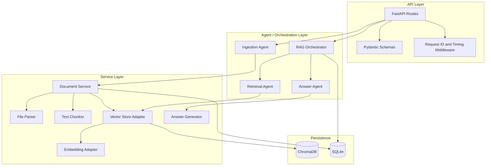
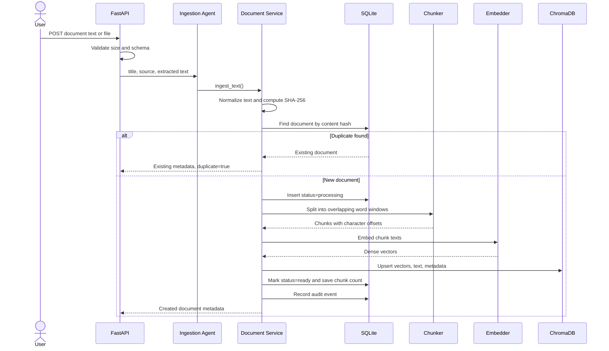
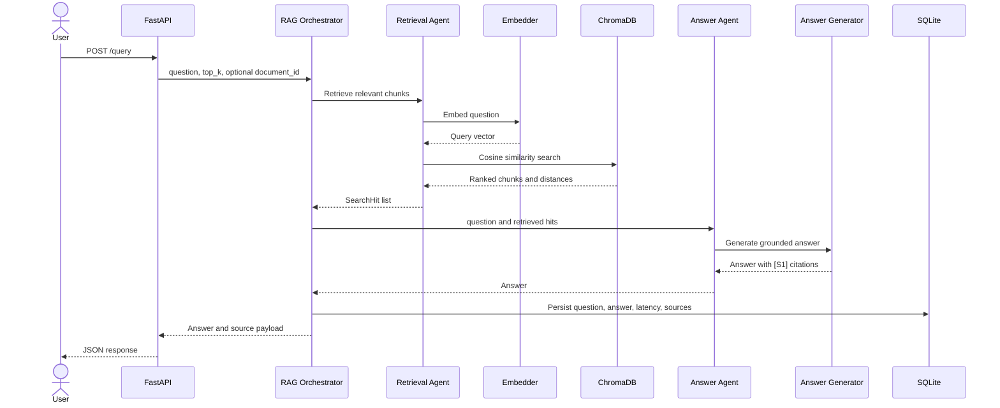
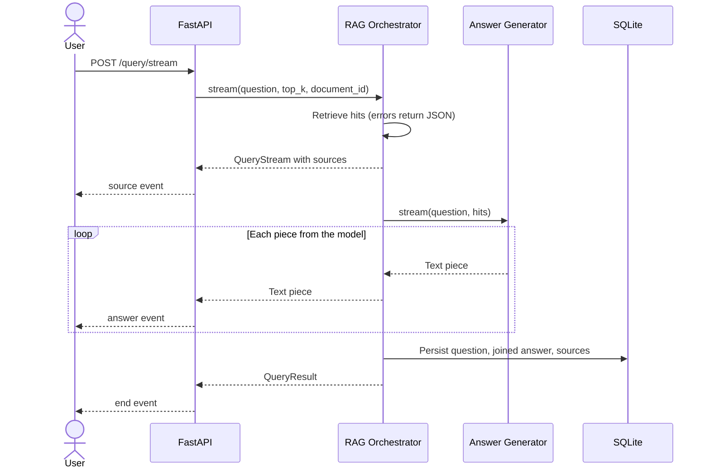

# Architecture

## 1. System goal

The system answers questions using only information found in user-provided documents. It separates the workflow into an **ingestion path** and a **query path**.

- The ingestion path converts source documents into searchable vector chunks.
- The query path retrieves semantically relevant chunks and generates a grounded answer.

## 2. Why two databases?

### ChromaDB

ChromaDB stores:

- Chunk text
- Dense vector embeddings
- Chunk-level metadata
- Document-to-chunk association

Its responsibility is semantic similarity search. Given a question embedding, it returns nearby chunk embeddings.

### SQLite

SQLite stores:

- Document lifecycle metadata
- SHA-256 content hashes
- Ingestion status
- Query history
- Query-to-source trace records
- LLM call log: one row per provider attempt, with token usage, latency and outcome
- Audit events

Its responsibility is transactional application state and operational traceability. ChromaDB is not treated as the canonical store for document lifecycle or query audit data.

Schema changes are versioned migrations in `app/db/migrations.py`. On startup the app applies any that a database hasn't recorded in its `schema_migrations` table, each in its own transaction. Shipped migrations are never edited; a change is always a new migration.

## 3. Component view



## 4. Ingestion flow



### Ingestion design details

1. **File validation**: TXT, Markdown, and PDF are accepted. Upload size is capped.
2. **Text extraction**: Text files are decoded as UTF-8. PDF pages are parsed with `pypdf`.
3. **Deduplication**: A SHA-256 hash of normalized text prevents duplicate vector storage.
4. **Lifecycle state**: SQLite first records the document as `processing`.
5. **Chunking**: Text is split by word count with overlap. Each chunk records source character offsets.
6. **Embedding**: Chunk vectors are generated in one batch.
7. **Indexing**: ChromaDB receives deterministic chunk IDs such as `document-id:0`.
8. **Completion**: SQLite status becomes `ready` only after vector indexing succeeds.
9. **Compensation**: If indexing fails, partial vectors are deleted and the SQLite row is marked `failed`.

The two stores cannot participate in one ACID transaction. The service therefore uses a small saga-style workflow with compensating cleanup. In a distributed version, an outbox and repair worker would make this more durable.

## 5. Query flow



### Streaming

`POST /query/stream` runs the same retrieval and the same prompt, but sends the answer as Server-Sent Events while the model generates it.



Retrieval happens before the response starts, so its errors keep the JSON error shape and HTTP status. After that the status line has been sent, so a failure becomes a final `error` event. The query is saved only after the last piece, so a stream that fails or that the client abandons leaves nothing in SQLite, just as a failed `/query` doesn't.

## 6. Agent responsibilities

### Ingestion Agent

The Ingestion Agent is a use-case coordinator. It invokes the document service, which performs deduplication, chunking, persistence, and compensation.

It does not independently “reason.” Calling it an agent is justified by its owned goal and bounded workflow, not by sprinkling an LLM onto every method like seasoning.

### Retrieval Agent

The Retrieval Agent:

- Validates the question
- Embeds it
- Over-fetches from the vector store: `min(max(top_k * 2, 20), 500)` hits
- Optionally filters to one document
- Drops hits below `min_relevance_score`, whichever answer provider is configured
- Keeps the best remaining hits, up to `top_k`, whose estimated tokens fit the retrieval budget: `max(int((llm_context_window - llm_reserved_tokens) * 0.9), 100)`, at about four characters per token
- Returns normalized `SearchHit` objects

### Answer Agent

The Answer Agent abstracts answer generation. Two strategies are included:

- `ExtractiveAnswerGenerator`: fully local and deterministic
- `OpenAICompatibleAnswerGenerator`: asks the LLM providers through `FallbackLLM`

Each has `generate()`, which returns the whole answer, and `stream()`, which yields it in pieces. The extractive one yields its whole answer once.

### LLM providers and fallback

`app/services/llm.py` holds `FallbackLLM`: a list of OpenAI-compatible providers, the primary from `RAG_LLM_*` and then `RAG_LLM_FALLBACKS`, tried in order.

- `complete()` moves to the next provider on any upstream error: an HTTP error status (including 429 rate limits), a timeout, a connection failure or a malformed response. When every provider fails, the caller gets a 502.
- `stream()` sends `"stream": true` with `stream_options.include_usage` and reads the server's SSE `delta` chunks until `[DONE]`. It moves to the next provider only while nothing has been yielded yet: once a client has seen part of an answer, a second provider would start a different one, so the stream ends with an error instead.
- Every attempt is recorded in `llm_calls` with the provider, model, purpose, token usage, latency and outcome, against the id of the query being answered. The orchestrator chooses that id before retrieval so the rows exist even when the query itself fails. Token counts come from the provider's `usage`; when none is reported they are estimated at about four characters per token and the row says so.
- `check_providers()` calls `GET /models` on each provider for the deep health check.

### RAG Orchestrator

The orchestrator owns the full question-answering transaction:

1. Retrieve context
2. Generate answer
3. Measure latency
4. Persist query and source trace
5. Return a stable API model

`stream()` does the same, but returns the sources straight after retrieval and then yields the answer piece by piece, saving the query after the last one.

## 7. Chunking strategy

The chunker uses:

- Configurable `chunk_size_words`
- Configurable `chunk_overlap_words`
- Source character offsets

Overlap helps preserve facts that cross a chunk boundary. Word-based chunking is simple and explainable. A later version could use tokenizer-aware chunking or semantic section splitting.

## 8. Embedding strategy

### Local default

`SentenceTransformerEmbedder` loads a configured Sentence Transformers model lazily. It uses document and query encoding methods when the installed model API provides them and normalizes vectors before storage. It needs the `local` extra (`pip install -e ".[local]"`), which brings in torch; the app refuses to start without it and says so.

### Remote option

`OpenAICompatibleEmbedder` calls `POST {base_url}/embeddings` in batches of `embedding_batch_size` texts and normalizes the vectors. It works with any server that implements the OpenAI embeddings API, including Google AI Studio and Ollama, and lets the Docker image skip torch (`LOCAL_EMBEDDINGS=false`).

Each embedder has a signature (`sentence-transformers:<model>`, `openai-compatible:<model>`, `hashing:v1:<dimension>`) that is stored on the Chroma collection when it is created. Opening a collection with a different signature is refused with a 409, because vectors from different models can't be compared. Use a new collection name when switching models.

Similarity scores depend on the model. MiniLM scores unrelated text near 0, so the default `min_relevance_score` of 0.15 works. Gemini embeddings score unrelated text around 0.4 to 0.5, so the threshold needs raising for them; see the README.

### Test strategy

`HashingEmbedder` produces deterministic normalized vectors without downloading a model. Tests use this together with `InMemoryVectorStore` so they remain fast and offline.

The production adapter and test double implement the same protocols. This is the dependency inversion that makes the service testable rather than merely hopeful.

## 9. Similarity and score conversion

The Chroma collection uses cosine distance. Chroma returns distance, while the API exposes a relevance-like score:

```text
score = clamp(1 - cosine_distance, 0, 1)
```

The score is convenient for clients, but it is not a calibrated probability. In production, the acceptance threshold should be selected using an evaluation dataset.

## 10. Grounding and hallucination controls

- The answer generator receives only retrieved chunks.
- Every chunk is wrapped in a numbered `<document index="n">` tag and cited as `[Sn]`; the API's `sources` list is exactly those chunks, in that order.
- The LLM prompt says the documents are reference data, not instructions, and asks the model to cite sources and refuse unsupported answers. Wrapper tags inside chunk text are escaped so a document can't close or fake a block.
- A minimum relevance threshold applies to every answer provider. When nothing passes it, the LLM is told the search found nothing rather than receiving an empty context.
- Source chunks are returned in the API response for verification.
- Query-to-source rows are persisted for audit and evaluation.

## 11. Error handling

| Failure | Current behavior |
|---|---|
| Empty text or question | HTTP 400 |
| Unsupported file type | HTTP 415 |
| Oversized upload | HTTP 413 |
| Missing document | HTTP 404 |
| Duplicate content | Existing document returned with HTTP 200 |
| Embedding/index failure | Document marked failed; partial vectors deleted |
| LLM provider fails | Next fallback provider is tried; HTTP 502 once all have failed |
| LLM failure during a stream | Next provider if nothing was sent yet; otherwise a final `error` event and the query is not saved |
| Embedding API failure | HTTP 502 on queries; the document is marked failed on ingestion |
| ChromaDB unreachable | `/health` reports `degraded` |
| Client disconnects during a stream | The app stops reading the model's stream; query not saved |
| Embedding-model mismatch | HTTP 409 with remediation guidance |

## 12. Observability

Every response includes:

- `X-Request-ID`
- `X-Process-Time-Ms`

`GET /health` checks SQLite and ChromaDB; `GET /health?deep=true` also embeds a test string and contacts each LLM provider.

Every LLM call attempt is logged in `llm_calls`, and `GET /stats` totals the calls, failures and tokens. The application also stores query latency and source traces. A larger deployment should export metrics such as:

- Ingestion duration
- Embedding duration
- Query latency percentiles
- Empty-retrieval rate
- Average top-1 similarity
- LLM failure rate
- Answer faithfulness and citation accuracy

## 13. Scaling path

### Current local architecture

- One FastAPI process
- Local SQLite
- Local persistent ChromaDB
- Synchronous ingestion

### Medium scale

- Multiple API workers
- PostgreSQL instead of SQLite
- Object storage for originals
- Queue-backed ingestion workers
- Chroma server or managed vector database
- Redis for hot query cache

### Large scale

- Separate ingestion and query services
- Kafka or another durable queue
- Embedding worker autoscaling
- Vector index partitioning by tenant or corpus
- Hybrid dense plus lexical retrieval
- Cross-encoder reranking
- Evaluation and feedback pipeline
- Outbox pattern and consistency repair worker

## 14. Security gaps to close before internet exposure

- Authentication and tenant authorization
- Per-document access-control filters during retrieval
- Malware scanning
- MIME-type verification rather than extension-only checks
- Prompt-injection detection and source trust policies
- Secret management
- Rate limiting
- Encryption and retention controls
- PII redaction where required
