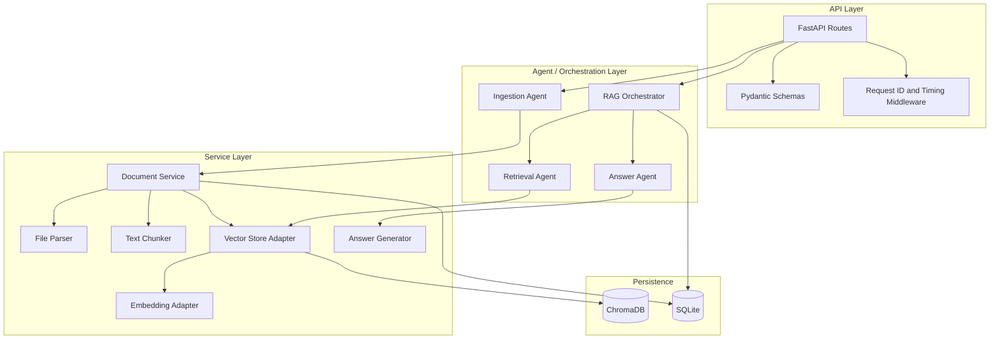
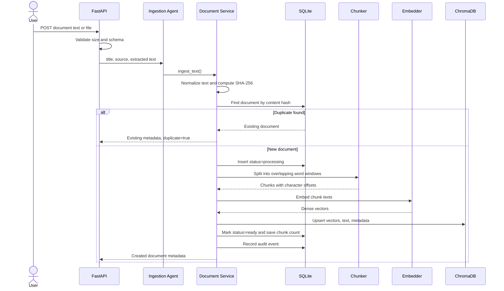
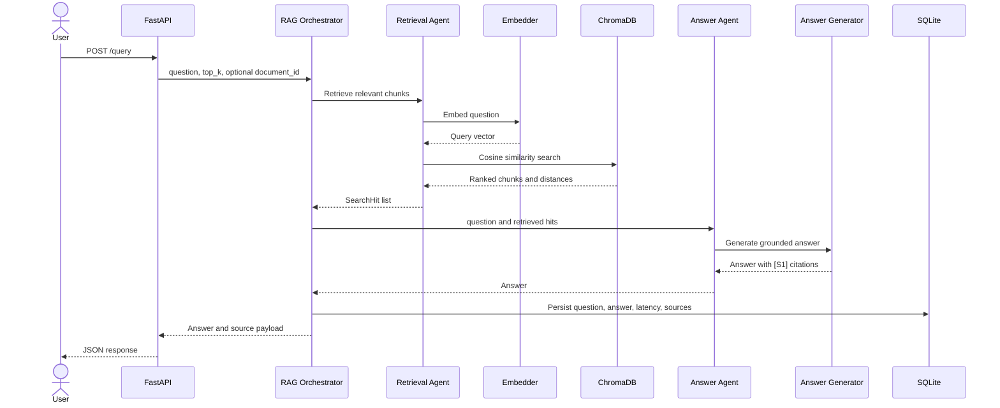

# Architecture

## 1. System goal

The system answers questions using only information found in user-provided documents. It separates the workflow into an **ingestion path** and a **query path**.

- The ingestion path converts source documents into searchable vector chunks.
- The query path retrieves semantically relevant chunks and generates a grounded answer.

## 2. Why two databases?

### ChromaDB

ChromaDB stores:

- Chunk text
- Dense vector embeddings
- Chunk-level metadata
- Document-to-chunk association

Its responsibility is semantic similarity search. Given a question embedding, it returns nearby chunk embeddings.

### SQLite

SQLite stores:

- Document lifecycle metadata
- SHA-256 content hashes
- Ingestion status
- Query history
- Query-to-source trace records
- Audit events

Its responsibility is transactional application state and operational traceability. ChromaDB is not treated as the canonical store for document lifecycle or query audit data.

## 3. Component view



## 4. Ingestion flow



### Ingestion design details

1. **File validation**: TXT, Markdown, and PDF are accepted. Upload size is capped.
2. **Text extraction**: Text files are decoded as UTF-8. PDF pages are parsed with `pypdf`.
3. **Deduplication**: A SHA-256 hash of normalized text prevents duplicate vector storage.
4. **Lifecycle state**: SQLite first records the document as `processing`.
5. **Chunking**: Text is split by word count with overlap. Each chunk records source character offsets.
6. **Embedding**: Chunk vectors are generated in one batch.
7. **Indexing**: ChromaDB receives deterministic chunk IDs such as `document-id:0`.
8. **Completion**: SQLite status becomes `ready` only after vector indexing succeeds.
9. **Compensation**: If indexing fails, partial vectors are deleted and the SQLite row is marked `failed`.

The two stores cannot participate in one ACID transaction. The service therefore uses a small saga-style workflow with compensating cleanup. In a distributed version, an outbox and repair worker would make this more durable.

## 5. Query flow



## 6. Agent responsibilities

### Ingestion Agent

The Ingestion Agent is a use-case coordinator. It invokes the document service, which performs deduplication, chunking, persistence, and compensation.

It does not independently “reason.” Calling it an agent is justified by its owned goal and bounded workflow, not by sprinkling an LLM onto every method like seasoning.

### Retrieval Agent

The Retrieval Agent:

- Validates the question
- Embeds it
- Runs top-k vector search
- Optionally filters to one document
- Returns normalized `SearchHit` objects

### Answer Agent

The Answer Agent abstracts answer generation. Two strategies are included:

- `ExtractiveAnswerGenerator`: fully local and deterministic
- `OpenAICompatibleAnswerGenerator`: calls `/v1/chat/completions`

### RAG Orchestrator

The orchestrator owns the full question-answering transaction:

1. Retrieve context
2. Generate answer
3. Measure latency
4. Persist query and source trace
5. Return a stable API model

## 7. Chunking strategy

The chunker uses:

- Configurable `chunk_size_words`
- Configurable `chunk_overlap_words`
- Source character offsets

Overlap helps preserve facts that cross a chunk boundary. Word-based chunking is simple and explainable. A later version could use tokenizer-aware chunking or semantic section splitting.

## 8. Embedding strategy

### Production default

`SentenceTransformerEmbedder` loads a configured Sentence Transformers model lazily. It uses document and query encoding methods when the installed model API provides them and normalizes vectors before storage.

### Test strategy

`HashingEmbedder` produces deterministic normalized vectors without downloading a model. Tests use this together with `InMemoryVectorStore` so they remain fast and offline.

The production adapter and test double implement the same protocols. This is the dependency inversion that makes the service testable rather than merely hopeful.

## 9. Similarity and score conversion

The Chroma collection uses cosine distance. Chroma returns distance, while the API exposes a relevance-like score:

```text
score = clamp(1 - cosine_distance, 0, 1)
```

The score is convenient for clients, but it is not a calibrated probability. In production, the acceptance threshold should be selected using an evaluation dataset.

## 10. Grounding and hallucination controls

- The answer generator receives only retrieved chunks.
- Every chunk is assigned a stable source label such as `[S1]`.
- The LLM prompt instructs the model to cite sources and refuse unsupported answers.
- The extractive fallback applies a minimum relevance threshold.
- Source chunks are returned in the API response for verification.
- Query-to-source rows are persisted for audit and evaluation.

## 11. Error handling

| Failure | Current behavior |
|---|---|
| Empty text or question | HTTP 400 |
| Unsupported file type | HTTP 415 |
| Oversized upload | HTTP 413 |
| Missing document | HTTP 404 |
| Duplicate content | Existing document returned with HTTP 200 |
| Embedding/index failure | Document marked failed; partial vectors deleted |
| LLM HTTP/JSON failure | HTTP 502 |
| Embedding-model mismatch | HTTP 409 with remediation guidance |

## 12. Observability

Every response includes:

- `X-Request-ID`
- `X-Process-Time-Ms`

The application stores query latency and source traces. A larger deployment should export metrics such as:

- Ingestion duration
- Embedding duration
- Query latency percentiles
- Empty-retrieval rate
- Average top-1 similarity
- LLM failure rate
- Answer faithfulness and citation accuracy

## 13. Scaling path

### Current local architecture

- One FastAPI process
- Local SQLite
- Local persistent ChromaDB
- Synchronous ingestion

### Medium scale

- Multiple API workers
- PostgreSQL instead of SQLite
- Object storage for originals
- Queue-backed ingestion workers
- Chroma server or managed vector database
- Redis for hot query cache

### Large scale

- Separate ingestion and query services
- Kafka or another durable queue
- Embedding worker autoscaling
- Vector index partitioning by tenant or corpus
- Hybrid dense plus lexical retrieval
- Cross-encoder reranking
- Evaluation and feedback pipeline
- Outbox pattern and consistency repair worker

## 14. Security gaps to close before internet exposure

- Authentication and tenant authorization
- Per-document access-control filters during retrieval
- Malware scanning
- MIME-type verification rather than extension-only checks
- Prompt-injection detection and source trust policies
- Secret management
- Rate limiting
- Encryption and retention controls
- PII redaction where required
